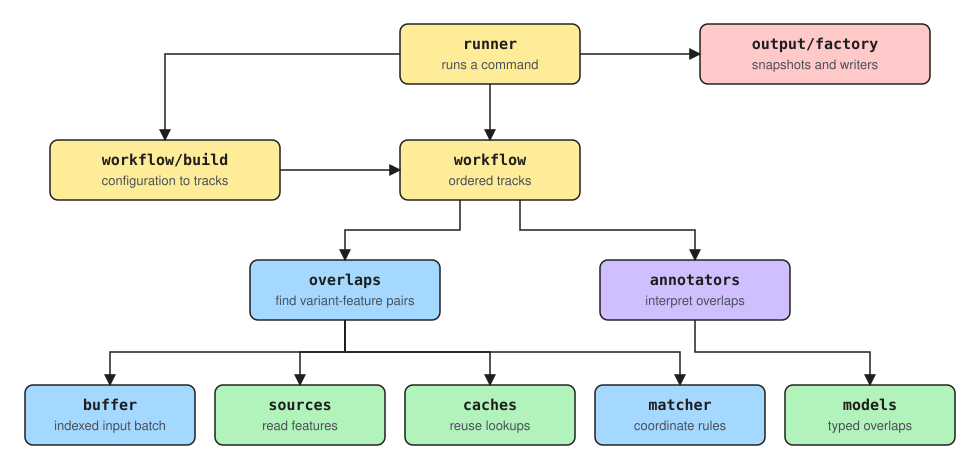
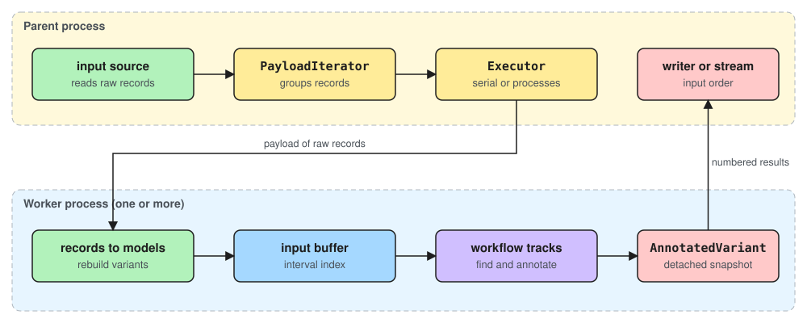

# Annotation architecture

This page describes how `vep run` turns input variants into annotations: which package does what, how data moves between processes, and where the extension points are. Per-class detail is in the docstrings, surfaced via the [API reference](../auto/reference/api/ensembl.vep.rst).

The design separates four concerns: **retrieval** (reading features), **association** (pairing variants with the features they overlap), **interpretation** (deciding what an overlap means) and **execution** (running all of this in order, in one or more processes). Each can change without the others needing to know how it works.

## Package responsibilities



| Package | Responsibility | Does not own |
|---|---|---|
| `runner/` | Runs a command: validates the request, schedules input, and coordinates output and the run summary. | Reading input records, output formats, or matching rules. |
| `workflow/` | Composes annotation tracks from the configuration and runs them over a batch of input. | Command-line parsing. |
| `overlaps/` | Finds candidate variant–feature pairs and builds typed overlap models. | Consequence interpretation. |
| `annotators/` | Turns typed overlaps into annotation values, such as consequence terms. | Feature retrieval. |
| `buffer/` | Holds one bounded batch of input variants and indexes them for candidate lookup. | Source handles or output. |
| `sources/` | Reads its format's records and builds domain features from them, including the input variants. | Variant-to-feature association. |
| `caches/` | Reusable lookup structures, such as interval trees and binned feature caches. | Matching rules or consequence logic. |
| `matcher/` | Pure coordinate and allele association rules. | Fetching, model construction or caching. |
| `models/` | The domain model: sequence regions, features, variations and the typed overlaps between them. | How any of them are read or written. |
| `output/factory/` | Detaches annotated variants from the model and serialises them. | Retrieval or annotation. |

`workflow` is deliberately not called `annotation`: a workflow is an executable composition of tracks, whereas an annotator is only the part that interprets an overlap.

## Workflows and tracks

```text
workflow/
├── base.py                   # Workflow: ordered tracks and their lifecycle
├── executor.py               # PayloadIterator and Executor: batching and process execution
├── worker/
│   ├── base.py               # the Worker protocol: run(payload)
│   └── annotation.py         # the annotation worker
├── tracks/
│   ├── base.py               # AnnotationTrack, OverlapAnnotationTrack, TrackResources, TrackResult
│   ├── registry.py           # track builders
│   ├── consequence/
│   │   ├── transcript.py     # the transcript consequence track
│   │   └── regulatory.py     # placeholder
│   ├── custom.py             # placeholder
│   └── colocated.py          # placeholder
└── build/
    ├── registry.py           # workflow builders and command selection
    ├── default.py            # the default workflow
    └── haplo.py              # the haplotype workflow
```

A **track** owns everything one kind of annotation needs: its source, whatever it caches between batches, the rule pairing variants with features, the annotator, and where results are attached for output. `AnnotationTrack` is a protocol, so a workflow depends on the behaviour it needs rather than on a shared superclass. `OverlapAnnotationTrack` is the standard implementation: it batches a finder's overlaps into an annotator. `TrackResources` holds what every track shares, the reference sequence and the sequence-region synonyms.

A **workflow builder** reads the configuration and calls the registered track builders directly. Each track builder returns as many tracks as the configuration asks for: none for a kind of annotation nobody configured, one for each occurrence of a repeatable option. There is no intermediate specification of tracks.

Track builders and workflow builders have separate registries, so registering one cannot change the other.

## The implemented path

The working path today is narrow:

```text
run.default -> default workflow -> consequence.transcript track
```

It reads VCF input, retrieves complete GFF3/GTF transcripts, finds transcript overlaps, calculates consequences and writes VCF or JSON output. It is the reference implementation of the contracts on this page.

`workflow_for_command` maps a command to its workflow. The runner calls it before any worker starts, so an unimplemented command is reported once rather than by every worker. `build_default_workflow` then asks each registered track builder what the configuration gives it; today only `consequence.transcript` contributes.

The transcript track exposes its candidate window and overlap finder (`transcript_candidate_window`, `build_transcript_overlap_finder`), so `vep explain` pairs a variant with transcripts by the same rule a run uses.

Other names are extension points rather than working features:

| Extension | Present today | Still needed |
|---|---|---|
| Custom annotation | Custom feature and overlap models, and a registered builder that refuses `--custom` rather than ignoring it. | File sources, annotators and output. |
| Colocated variants | An overlap finder and a registered builder that contributes no track. | A source, an annotator and output. |
| Regulatory features | An overlap finder and a registered builder that contributes no track. | A source, a consequence path and output. |
| Haplotypes (`vep run haplo`) | Workflow and annotator registration. | Haplotype grouping and interpretation, and output. |

A registered class or finder is not a supported track until a run can build its whole path from source to output.

## Runtime data flow



The parent process never builds models. The input source yields one raw record at a time (for a VCF, the original line), and `PayloadIterator` groups records into payloads of at most `buffer_size` records from one sequence region. The `Executor` hands each payload to a worker, either in the same process or in a worker process.

A worker rebuilds the variants from the raw records, fills an input buffer, and runs the workflow over small windows of the buffer. After each window it detaches the results as `AnnotatedVariant` snapshots and releases the overlap models. The snapshots go back to the parent, numbered, with a summary of the batch.

The parent is the only writer. It collects results in payload order, whatever order the workers finish in, and either writes them with an output writer (`Runner.run`, used by the command line) or yields them from an `AnnotatedVariants` stream (`Runner.annotate`, used from Python; see [Streaming annotations in Python](../user_guide/tutorials/streaming_annotations.md)).

Raw records cross the process boundary instead of parsed records because a parsed record is neither picklable nor verbatim: the VCF parser normalises values such as `DP=007` to `7`. `PicklableVCFVariationSource` therefore uses the input line itself as its record, which both pickles and is what the VCF output echoes back.

## The runner

| Module | Responsibility |
|---|---|
| `runner/run/default.py` | Validate a request, connect the input source, payload iterator and executor, and coordinate output and summary. |
| `runner/run/haplo.py` | Provide the `vep run haplo` command. |
| `runner/run/output_transaction.py` | Stage the output and summary files and move them into place together. |
| `runner/run/progress.py` | Show progress against the number of input records. |

Progress is shown only when standard error is a terminal. The parent counts the input records first and advances the progress bar as ordered results are written, so workers never write to the terminal.

## Output factories

`output/factory/base.py` defines the boundary between annotation and output:

- `AnnotatedVariant` is one detached, format-neutral snapshot of an annotated variant: its coordinates, identity, input columns, and one output record per allele and feature.
- `AnnotatedVariantFactory` builds those output records from an annotated variation.
- `AnnotatedVariants` is the ordered, single-pass, closable stream returned by `Runner.annotate`. Its run summary is available once the stream has been read to the end.

The rest of the package separates adaptation from serialisation:

```text
output/factory/
├── base.py         # AnnotatedVariant, AnnotatedVariants, AnnotatedVariantFactory
├── stream/
│   ├── base.py     # the stream adapter protocol
│   └── json.py     # JSONStreamFactory: Ensembl VEP JSON dictionaries
└── write/
    ├── base.py     # the OutputWriter protocol
    ├── vcf.py      # VCFOutputWriter
    ├── json.py     # JSONOutputWriter
    └── registry.py # writer selection by output format
```

A stream adapter turns snapshots into Python values without writing a file; a writer turns them into lines of text. `JSONOutputWriter` delegates the record layout to `JSONStreamFactory`, so the JSON written by a run and the JSON returned to a Python caller are the same.

Nothing at write time touches a live model. A snapshot carries everything its output needs.

## Sequence-region names

The same region can be named differently by the input, the transcript file and the reference FASTA. Model slices always use the reference FASTA's names, so a run resolves names in three directions:

- input VCF names to reference names;
- transcript file names to reference names, while building transcripts;
- reference names back to the transcript file's names, for regional queries.

Each resolution tries the exact name, then a synonym from the `--synonyms` file, then the name with the `chr` prefix added or removed (ignoring case), and otherwise keeps the name unchanged. Results are cached per resolver.

The resolved name is used to build models and query sources, never for output: a `Variation` keeps the input's own spelling in `uploaded_locus.seq_region_name`, and output reads it from there.

## Lifetimes and caches

An `InputBuffer` owns its interval index and no source state, so a buffer holds nothing that cannot cross a process boundary. `FixedSizeInputBuffer` takes at most `buffer_size` objects, never mixes two sequence regions, and refuses input that appears unsorted.

Worker-local state owns the source handles, annotator contexts and feature caches. A worker builds them after it starts, rather than inheriting open files or live model graphs, which is required for the `spawn` start method and avoids relying on inherited state with `fork`.

Caches are passed to the code that uses them rather than being global:

- `IntervalTree` indexes the objects of one input buffer. `FeatureIntervalTreeCache` shares one tree between callers asking for the same region and source.
- `BinnedFeatureCache` keeps the transcripts loaded for one payload, and is cleared before the next payload so distant regions do not accumulate.
- `TranscriptPool` keeps built transcripts across payloads within a memory budget (`--transcript_pool_bytes`), evicting the least recently used. Transcripts are never changed after they are built, so reusing them is safe.
- Sequence, mapper, codon and zone-map caches live as long as the annotator context that owns them.

A cache must never change the annotations a run emits. Its only purpose is to avoid repeated parsing, I/O and coordinate work.

## Complete transcripts from GFF3 and GTF

A narrow regional query can return a transcript's own record but miss its distant exons. A transcript source therefore queries twice: first the region, to find the overlapping transcripts and their full spans, then the merged spans, to read every record of those transcripts. [Parsers and Feature Sources](parsers_and_feature_sources.md#sources) describes this two-stage query in detail.

Without an index, a source reads the file from the start for each payload and discards transcripts outside the payload's region before building them. This keeps memory bounded at the cost of repeated reads, so an indexed file is strongly recommended.

## Typed overlaps

An overlap finder produces the model appropriate to the pair:

- `TranscriptVariationAllele` or `TranscriptStructuralVariationAllele` for transcripts;
- `CustomVariationAllele` for custom records;
- `FeatureOverlap` for regulatory features and colocated variants, while their models are still generic.

A track returns `TrackResult` values that keep both the producing track and the typed overlap. Results are attached after the tracks run, so independently run tracks merge in a deterministic order.

## Coordinates and matching

Intervals use 1-based inclusive coordinates. An insertion is a zero-width point with `start = end + 1`, as described in [Position in a Sequence Region](coordinates_and_slices.md#insertion-coordinates). Candidate indexes widen an insertion to its two flanking bases for retrieval only; the matchers keep the zero-width form:

- `OverlapMatcher` accepts containment in either direction and partial overlap.
- `ExactCoordinateMatcher` requires identical `start` and `end`.
- `ReciprocalOverlapMatcher` compares overlap fractions of the reference span, and rejects insertions, whose fraction is undefined.

The transcript track looks up candidates in an *influence interval* that includes the `--distance` flank, so a variant just outside a transcript can still be called `upstream_gene_variant` or `downstream_gene_variant`. The overlap model itself still describes the real transcript span.

## Execution

Execution options are independent of the workflow: the workflow decides which tracks run, and the execution options decide how payloads run.

- **Serial**, the default (`--processes 1`), runs payloads in the parent process.
- **Worker processes** (`--processes N`) run payloads in parallel. A bounded number of payloads is in flight at once, and results are collected in order. Each worker has its own sources, caches and annotator context, so memory grows with the number of workers.
- **Track threads** (`--threads N`) run a worker's independent tracks in parallel. They do not split a track. Only the transcript track runs today, so threads do not speed a run up yet.

See [Improving performance](../user_guide/how_to/performance.md) for how to use these options.

## Extending the architecture

To read a new input format:

1. Add a source under `sources/` that builds `Variation` models in `records_to_features`.
2. Give it a picklable record and what a run needs to read it: `iter_all_records`, `region_of` and `record_columns` to place and echo a record, and `header_lines`. Override `record_count` when the format can count its records cheaply.
3. Add the format and its file extensions to `INPUT_FORMAT_EXTENSIONS` in `common/constants.py`, which is both what `--format` offers and how an input file name is recognised.
4. Add the format to `build_input_source`. The worker does not change.

To add an annotation track:

1. Add or reuse a `Feature` model and a source that builds complete features.
2. Choose a cache and candidate lookup with the right worker lifetime.
3. Reuse a matcher, or add a small pure matcher under `matcher/`.
4. Add a typed overlap model when the pair has its own geometry or state.
5. Implement an overlap finder that builds that model.
6. Implement an annotator that returns a typed result.
7. Register a track builder under `workflow/tracks/`, and name its kind in a workflow under `workflow/build/`.
8. Test that serial and threaded runs, and runs with caches disabled, give the same result, and that workers rebuild correctly under each supported start method.
