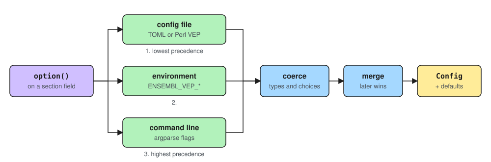

# Configuration

This page describes `ensembl.vep.config`: how an option is declared once and then reaches the command line, a configuration file, an environment variable and the Python API. [Configuring a run](../user_guide/how_to/configuring_a_run.md) shows how to use these from a user's point of view.

Two ideas carry the whole package:

- **An option is a declaration, not a parser.** A field on a configuration section carries an `option()` specification. The command-line flag, the environment variable, the configuration file key, the type conversion and the check of permitted values are all derived from that one declaration.
- **A layer carries only what it sets.** Each source of values produces a sparse layer, the layers are merged in order of precedence, and anything nobody set falls back to the field's own default.



## Package responsibilities

| Module | Responsibility |
|---|---|
| `config/option_spec.py` | `OptionSpec`, the `option()` helper, and `section_options` to read declarations back. |
| `config/sections/` | The sections: field names, types, defaults, converters and validators. |
| `config/sources.py` | `ConfigLayer`, `ConfigSource`, type coercion, choice checks and layer merging. |
| `config/parser/cli.py` | Builds an `argparse` parser from the declarations and parses arguments into a layer. |
| `config/parser/config.py` | Reads a TOML or Perl VEP configuration file into a layer. |
| `config/parser/env.py` | Reads `ENSEMBL_VEP_*` environment variables into a layer. |
| `config/parser/common.py` | Resolves a flat key, such as a file key or an API keyword, to the section and field that declare it. |
| `config/base.py` | The `Config` root, the section registry, `load()` and `Config.for_command()`. |

## Declaring an option

`option()` returns `attrs` field metadata, so a section field declares its own interface:

```python
distance: tuple[int, ...] = field(
    default=(DEFAULT_DISTANCE,),
    converter=_as_distances,
    metadata=option(
        "distance outside a feature still counted as overlapping, as one value or up,down",
        synonyms=("flank",),
        metavar="BP[,DOWNSTREAM]",
    ),
)
```

The `OptionSpec` attributes, and where each one has an effect:

| Attribute | Effect | Reaches |
|---|---|---|
| `help` | The `--help` text. | command line |
| `flag` | The long spelling, when it differs from the field name. | command line, file |
| `short` | A one-character flag, such as `-i`. | command line |
| `synonyms` | Further long spellings of the same option. | command line, file, API |
| `constants` | Flags that set a fixed value: `--vcf` means `--output_format vcf`. | command line, file, API |
| `choices` | The permitted values, or a callable returning them. | every layer |
| `metavar` | The value placeholder in `--help`. | command line |
| `env` | Overrides the derived environment variable name. | environment |
| `hidden` | Keeps the option out of `--help`, while it still works. | command line |
| `repeatable` | The option is given once per item, and each item is kept whole, commas included. | command line, file |

`section_options(section_type)` returns the declared options of a section in declaration order. Every parser, the coercion step and the [CLI reference](../auto/reference/cli/index.md) generator read the declarations through it; a field without `option()` metadata is invisible to all of them.

## Sections and the Config root

A section is a frozen `attrs` class with a `section_name`, grouping the options of one concern:

```python
@define(frozen=True, kw_only=True, auto_attribs=True)
class SourceConfig(ConfigSection):
    section_name: ClassVar[str] = "source"
```

A section owns three things no layer can override: the **default** of each field, a **converter** that normalises whatever arrives (`--output_file STDOUT` becomes `None`), and **validation** in `__attrs_post_init__` that rejects values no layer should produce. Sections are frozen; change one with `attrs.evolve`.

Sections are laid out by one rule: **a section read by commands from more than one group lives in `sections/common/`; a section read by only one group lives in that group's package.**

```text
config/sections/
├── base.py         # ConfigSection
├── common/         # logging, source, annotation, execution, corpus
├── run/            # run
├── explain/        # explain
├── stats/          # stats
├── corpus/         # describe, golden, save
├── catalogue/      # catalogue, write, add, remove, show, costs, validate
└── bench/          # bench, endtoend, matrix, oracle, sweep
```

`Config` is the root: one field per section, plus `command` and `sources`, the record of which layer supplied each value. Its main members are:

| Member | Purpose |
|---|---|
| `Config.section_types` | Every section name and its class. |
| `Config.section_types_for(names)` | The classes for one command's sections. |
| `config.section(name)` | One configured section. |
| `config.source_of(section, field)` | Which layer supplied a value. |
| `config.as_mapping()` | `{section: {field: value}}` for the declared options. |

**Which sections a command reads is the command's own declaration.** Every runner lists its `sections`, and the command-line parser is built from exactly those. `vep catalogue show --fasta x` is therefore rejected: `catalogue show` does not read the `source` section.

## Layers

A `ConfigLayer` maps section names to field names to values, and holds only what its source actually set. `ConfigSource` names the sources, in increasing precedence:

| `ConfigSource` | Produced by | Keyed by |
|---|---|---|
| `DEFAULT` | the field's own default | — |
| `FILE` | `read_config_file` | a TOML table and key, or a flat Perl VEP key |
| `ENVIRONMENT` | `read_environment` | `ENSEMBL_VEP_<SECTION>_<FIELD>`, or `env` on the specification |
| `COMMAND_LINE` | `parse_args` | the flag, short flag, synonym or constant flag |

**Command line.** `build_parser` adds each section as its own group in `--help`, after checking that no two sections of the command declare the same flag. Every argument defaults to `argparse.SUPPRESS`, so a flag that was not given is absent from the layer, rather than present with its default. Destinations are namespaced by section, because two sections of one command can declare the same field name: `format` is the input format in `source` and the report format in `stats`. A boolean option carries both its spellings, `--zone_map` and `--no_zone_map`, in one action.

**File.** A file with a `[table]` header, or that parses as TOML with at least one table, is read as TOML; a syntax error in such a file is reported rather than the file being reread in another format. Any other file is read as a Perl VEP configuration file: one key and value per line, a leading `#` starts a comment, quotes are removed, and the first occurrence of a repeated key wins.

**Environment.** The variable name is derived from the section and the field name only. Synonyms are a command-line and file convenience, so each option has exactly one environment variable.

## Coercion, validation and merging

`coerce_layer` converts every value of a layer to its declared type: booleans from `1`/`true`/`yes`/`on` and `0`/`false`/`no`/`off`, paths, enumerations by member name ignoring case, tuples by splitting on commas, and numbers and strings directly. For an optional field, an empty value means `None`. It also checks `choices` for every layer, so a bad value in a file or an environment variable fails the same way a bad flag does, naming the option.

An unknown section is ignored silently, because one file can serve several commands. An unknown option inside a known TOML table is ignored with a warning.

`merge_layers` applies the layers in order, so the last layer to set an option wins. Nothing fills in defaults on the way:

1. each layer holds only the options it set;
2. the merged layer holds only the options someone set;
3. each section is built from just those values;
4. every other field takes the default declared on it, and `source_of` reports `DEFAULT`.

A default therefore has exactly one home, the field, and no layer needs to know it.

## Building a Config

There are three ways to build a `Config`:

- **`load()`** is what the command line uses. It reads the configuration file, the environment and the arguments into layers, merges them, builds each section and records which layer supplied each value.
- **`Config.for_command()`** is the Python API. It takes flat option names as keyword arguments, so a caller never needs to know which section declares an option, and accepts synonyms and constants (`flank=100`, `vcf=True`). A keyword the command does not read raises a `ValueError`.
- **Direct construction**, such as `Config(command="run.default", source=SourceConfig(...))`, pins whole sections. It is mostly used in tests: converters and validators still run, but synonyms and constants do not apply.

| | Checks choices | Synonyms and constants | Records sources |
|---|---|---|---|
| `load()` | yes | yes | yes |
| `Config.for_command()` | yes | yes | no |
| `Config(...)` | only the section's own validators | no | no |

## Perl VEP spellings

Options that Perl VEP also has keep its spelling, through `synonyms` and `constants` rather than a second declaration. For example, `--fork` sets `processes`, `--flank` sets `distance`, and `--vcf` sets `output_format` to `vcf`. Each command's spellings are listed in the [CLI reference](../auto/reference/cli/index.md).

One naming rule follows: `--format` is always the *input* format, so a report's format is always called `output_format`. Otherwise, commands that read the `source` section would have two `--format` flags.

## Adding an option

1. Choose the section by the layout rule: an option read by more than one command group goes in `sections/common/`.
2. Declare the field with a type, a default, and `option()` with a one-line help string.
3. If Perl VEP has the same option under another name, add that name as a synonym, or as a constant when it sets a fixed value.
4. If the option has a fixed set of values, give it `choices`, which every layer then checks.
5. Normalise values with a converter on the field, and reject invalid combinations in `__attrs_post_init__`; both apply to every layer.
6. Add tests for the layers that matter. The option appears in `--help`, and in the CLI reference, for every command that reads its section.
