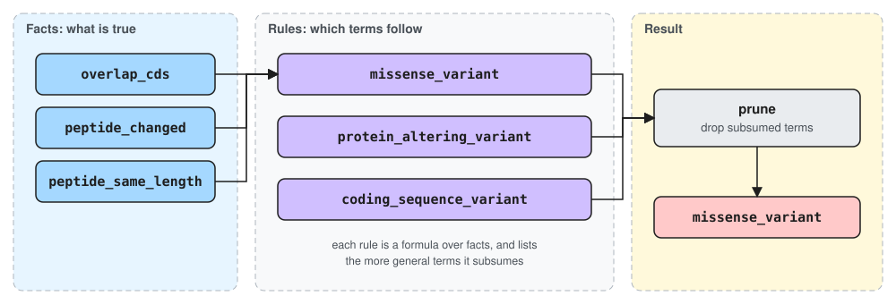

# Consequence annotation

This page describes how Ensembl VEP decides which [Sequence Ontology](https://www.sequenceontology.org/) (SO) consequence terms apply to a variant, and how to work on that code safely. Every term and its rule are listed in the [consequence terms reference](../auto/reference/consequence_terms.md), and [Explaining a consequence call](../user_guide/tutorials/explaining_consequences.md) shows the process on a real variant.

## Facts, rules and annotators

The consequence logic is split three ways:

- **Facts** are named, memoised properties of one variant allele against one feature, such as `overlap_cds` or `peptide_changed`. Each fact declares its cost and the facts it depends on.
- **Rules** define each SO term as a boolean formula over facts, plus a list of the more general terms it **subsumes**.
- **Annotators** are interchangeable strategies that evaluate the rules for a batch of overlaps.



When a rule fires, the terms it subsumes are removed from the result, so only the most specific terms are reported. In the example above, `missense_variant`, `protein_altering_variant` and `coding_sequence_variant` all fire, and pruning leaves `missense_variant`.

Suppression is declared on the winning term, in the catalogue, rather than written into the conditions of the terms it suppresses. Adding a term therefore touches one catalogue entry.

**The invariant that makes this safe:** every annotator must produce exactly the same terms. A new strategy is a candidate you compare against the existing ones, not a rewrite you have to trust.

## Where things live

```text
src/python/ensembl/vep/annotators/
├── base.py                  # Annotator: the contract shared by every kind of annotator
├── registry.py, factory.py  # annotator names, and build_annotator() from plain values
├── consequence/
│   ├── data/
│   │   ├── overlap_consequences.json  # the catalogue: every SO term, its rule and subsumes
│   │   └── fact_costs.json            # measured fact costs
│   ├── context/             # FactContext (one overlap) and AnnotatorContext (one run)
│   ├── facts/               # what is true: kind, position and sequence facts
│   ├── rules/               # which term follows: catalogue, expressions, rule sets, validation
│   └── strategies/          # how to work it out: linear, staged, columnar, columnar-staged, columnar-kernels
└── haplo/                   # the haplotype annotator (scaffolding)

src/python/ensembl/vep/trace/   # opt-in record of why a term came out, used by vep explain
src/rust/annotators/            # native batch kernels for cheap fact columns
```

Tests mirror the source tree under `src/python/tests/`.

### The two contexts

The two contexts differ only in lifetime:

- `FactContext` is **one variant–feature overlap**. It holds the memo table of computed facts, the cost counters, and intermediate values that several facts share.
- `AnnotatorContext` is **one annotation run**. It holds every cache whose unit of reuse is larger than one overlap, such as the zone map and the codon cache.

Pass one `AnnotatorContext` to every annotator that should share caches; without one, each annotator gets its own empty context. **Whether caches are shared must never change the terms produced.**

## The annotators

All annotators produce the same terms. They differ in how much work they avoid:

| Name | Strategy |
|---|---|
| `consequence.linear` | Evaluates the rules in rank order, one overlap at a time. **The reference for conformance.** |
| `consequence.staged` | Computes cheap facts first and uses the `requires` declarations to settle rules without computing expensive facts. |
| `consequence.columnar` | Evaluates each fact for a whole batch of overlaps at once, as a bit column. |
| `consequence.columnar-staged` | Combines the columnar and staged approaches. **The default annotator.** |
| `consequence.columnar-kernels` | `columnar-staged`, with the cheap fact columns filled by native batch kernels. |

`--annotator` selects one. The zone map and the codon cache are not strategies: they are caches any strategy can use, enabled with `--zone_map` and `--codon_cache`.

Facts are grouped into cost tiers, from cheapest to most expensive: `FREE` (arithmetic on the variant alone), `BOUNDS` (comparing against one bound), `INTERVAL` (scanning exon and intron lists), `MAPPING` (genomic to CDS coordinate mapping), `SEQUENCE` (building and translating the changed sequence) and `TRANSCRIPT_SEQUENCE` (rebuilding the whole CDS or cDNA). The tiers order facts correctly, but their numeric values are relative, not measured times.

## Common tasks

### Add or remove an SO term

```bash
vep catalogue add --dry_run --term my_term --accession SO:0001234 --impact MODERATE \
  --so_parent SO:0001060 --when '"overlap_cds"'
vep catalogue remove --term my_term --catalogue my_catalogue.json
```

Both commands write the catalogue named by `--catalogue`, replace the packaged catalogue only with `--catalogue_overwrite`, and write nothing with `--dry_run`. `vep catalogue add` derives `subsumes` from the SO parents (if A *is a* B, A is more specific, so A subsumes B), renumbers the ranks, and validates the catalogue before writing it. `vep catalogue remove` also removes references to the term from other entries' `subsumes`.

It never invents a `when` formula. A plausible but wrong rule passes conformance, because every annotator agrees on the same wrong answer, and only shows up later as bad biology. You write the rule.

`vep catalogue validate` checks the catalogue, and `vep catalogue show` prints every term with the formula it evaluates.

### Name a fact

Positional facts name the relation between the variant and the thing it is tested against, using one of four prefixes:

| Prefix | Meaning |
|---|---|
| `within_` | the variant lies entirely inside the feature |
| `contain_` | the variant entirely contains the feature |
| `intersect_` | partial overlap: each side has a part the other does not cover |
| `overlap_` | any overlap at all |

The noun is the thing tested against. Use `feature` rather than `transcript` wherever a fact reads only the feature's start and end, because such a fact holds for any kind of feature.

Not everything in `consequence/facts/` is a boolean rule atom. Whether a non-boolean intermediate should be a registered fact or a plain helper is described in the module docstring of `consequence/facts/base.py`, which is the source of truth for that rule. Plain helpers live in `consequence/facts/helper.py`.

### Add a fact

Facts are grouped by the question they answer: `kind.py` (what kind of feature or variant), `position.py` (coordinate comparisons) and `sequence.py` (sequence and peptide content). Register a new fact in the matching module, with a cost tier and, if it only applies when another fact is true, a `requires` declaration:

```python
@register_fact(CostTier.MAPPING, deps=("overlap_exon",), requires=("overlap_exon",))
def my_new_fact(fact_context): ...
```

`deps` must be *computed* first; `requires` must be *true* first. The staged strategies use `requires` to settle rules without computing anything.

**`requires` is enforced by the decorator.** The body only runs when every required fact is true, so do not start it with your own check of the same fact. `requires` names are added to `deps` automatically, so declare each one once.

A fact can contain arbitrary code, such as loops over exons, when a property cannot be written as a formula. It may read other facts through `get_fact`, but **must never call another fact's function directly**: going through `get_fact` keeps memoisation, cost accounting and the declared dependencies intact. Declare its cost and dependencies honestly, because every strategy reasons from them.

### Add an annotator

Subclass `ConsequenceAnnotator`, implement the overlap evaluation, register it with `@register_annotator("consequence.my_strategy")`, and import it from `consequence/strategies/__init__.py`. Conformance tests and `vep bench` find registered annotators automatically.

Call `self.annotator_context.prepare(fact_context)` once per overlap, before computing any fact, and the strategy supports every cache with no further work. Register a new name only for a genuinely different evaluation strategy: "with a cache attached" is a constructor argument, not a strategy.

### Fill a fact column with a native kernel

`consequence.columnar-kernels` fills some fact columns with kernels in `src/rust/annotators/batch_kernels.rs`. The kernels take flat integer arrays and nothing else: they know nothing about transcripts, so they cannot fall out of step with the model.

To add one, write a kernel that takes integer arrays and returns a packed bitmap, export it from the extension module, and have the annotator's `seed_columns` hand the arrays to it. Only seed facts that no other fact reads through `get_fact`: copying a seeded column back into each overlap's memo costs more than the kernel saves.

### Handle another kind of feature

One rule set covers every kind of feature. A rule that applies to one kind says so in its own formula, through the kind facts in `consequence/facts/kind.py` (`is_transcript`, `is_motif`, `is_regulatory`, `is_structural`). Each rule's cheap guard picks those facts up automatically, so a batch mixing transcripts and regulatory features settles the rules of the wrong kind on a type check.

### Find out why a term did or did not appear

`vep explain` shows each fact's value and how it was obtained, the verdict of each rule and why it was settled, the pruning, and the emitted terms. `--compare` explains one overlap with two annotators and reports the first difference, which is the tool to use when a conformance test fails. See [Explaining a consequence call](../user_guide/tutorials/explaining_consequences.md).

Tracing costs nothing when it is off. A run records only what cannot be recovered afterwards, such as how often each fact was read; everything else is reconstructed from the finished fact context by `trace/reconstruct.py`.

## Pitfalls

- **Conformance is the gate.** A new strategy must give the same terms as `consequence.linear` on the test corpora before its speed means anything.
- **Skipping a rule because something suppresses it is not sound on its own.** A fired term that is itself pruned still removes the terms it subsumes, so skipping it can let one of those terms wrongly survive. A rule may only be skipped when its own `subsumes` are already covered by another fired term.
- **The cost tiers are a model, not a measurement.** They rank strategies correctly, but measured times are much flatter, so do not treat the numbers as absolute.
