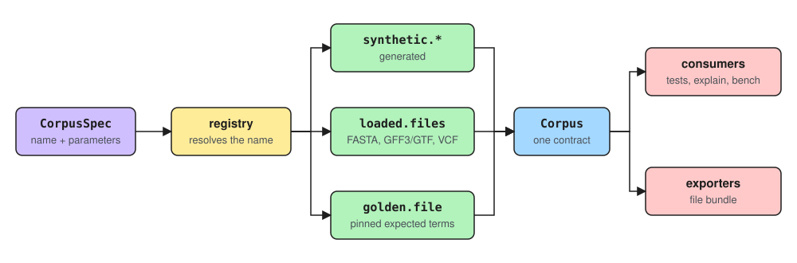

# Test corpora

A **corpus** is a deterministic set of sequence regions, transcripts, variants and the overlaps between them. Corpora are the inputs for the consequence tests, for `vep explain`, for `vep stats --profile` and for `vep bench`. A consumer asks for a `Corpus` and does not need to know whether it was generated, loaded from files, or paired with expected results.



## The Corpus contract

`Corpus` is the consumer-facing contract. It exposes:

- the `CorpusSpec` it was built from;
- every sequence region it refers to;
- named variation alleles;
- transcripts;
- named transcript overlaps; and
- the lifetime of any resources it holds, through `close()` and the context-manager protocol.

The contract is transcript-oriented, because the consequence annotators consume `TranscriptVariationAllele` overlaps. A database-backed transcript corpus would fit it as it is; a regulatory or motif corpus would need the contract to be extended with those feature and overlap types.

`CorpusSpec` is a registered corpus name plus scalar parameters. The registry resolves the name to a factory, and the factory interprets and validates the parameters. The registered corpora are:

| Name | Corpus |
|---|---|
| `synthetic.default` | A generated corpus covering consequence boundaries, with randomised variants added by `--fuzz`. |
| `synthetic.heavy` | A generated dense locus where many variants share transcripts. |
| `synthetic.all` | Both synthetic corpora combined. |
| `loaded.files` | A corpus read from a FASTA, GFF3 or GTF, and VCF file. |
| `golden.file` | A corpus paired with pinned expected consequence terms. |

`--kind` selects a corpus on the commands that use one. `vep corpus describe` lists a corpus's regions, transcripts, variant classes and every selectable overlap.

## Package structure

```text
corpus/
├── base.py             # the Corpus contract
├── spec.py             # CorpusSpec: a registered name and its parameters
├── registry.py         # corpus factory registration and construction
├── combine.py          # combine compatible corpora
├── validation.py       # naming and identity invariants across collections
├── overlap.py          # build transcript overlaps from variants and transcripts
├── annotate.py         # rebuild annotated variations from a corpus, as a run would
├── describe.py         # corpus descriptions
├── synthetic/
│   ├── base.py         # SyntheticCorpus
│   ├── default.py      # the synthetic.default recipe
│   ├── heavy.py        # the synthetic.heavy recipe
│   └── components/     # reusable sequence, transcript and variation builders
├── loaded/
│   ├── base.py         # LoadedCorpus and the resources it owns
│   └── files.py        # the loaded.files factory
├── golden/
│   ├── base.py         # GoldenCorpus
│   ├── resolve.py      # load a golden corpus, or generate one when none exists
│   ├── terms.py        # serialised expected terms
│   └── data/           # packaged corpus files and expected terms
└── exporter/
    ├── base.py         # the CorpusExporter protocol
    ├── registry.py     # exporter registration and lookup
    ├── manifest.py     # exported corpus metadata
    └── formats/file/   # coordinated FASTA, GFF3 and VCF export
```

Tests mirror this structure under `src/python/tests/corpus/`.

## Kinds of corpus

### Synthetic

A synthetic module defines one recipe: it builds sequence regions, transcripts and variants, then calls the shared overlap builder, and registers one factory name.

Reusable construction belongs in `synthetic/components/`; recipe-specific coordinates stay in the recipe module. The exon layouts and CDS offsets of a recipe are declared at the top of its module, so a locus can change without editing the construction code. Recipes fill their sequence with an alphabet that contains no stop codons, then place the start and stop codons explicitly. CDS offsets are measured along the spliced transcript, so a start offset longer than the first exon continues into the next exon rather than into the intron.

### Loaded

`LoadedCorpus` holds a materialised corpus together with the resources it must keep open, such as sequence sources, and closes them once, in reverse order of acquisition.

`loaded.files` is one factory, not the definition of a loaded corpus. It reads the FASTA, transcript and VCF files through the same sources a run uses, reconciles their sequence regions, and builds the overlaps. A database loader would build the same model objects, keep its connection as a corpus resource, and register its own name.

### Golden

`GoldenCorpus` pairs another corpus with pinned expected consequence terms. Resolution loads an existing packaged or configured dataset first. Generating a new one with the reference annotator is a fallback only when the dataset directory is absent: existing data that cannot be read is an error rather than being replaced silently.

## Exporters

Export is independent of how a corpus was built. `get_exporter(name)` returns an exporter, and `export(corpus, destination, force=...)` writes it. The `file` exporter writes a FASTA, GFF3 and VCF file and a manifest, in the conventions the run's readers expect, with each variant's name in the VCF `ID` column:

```bash
vep corpus save --kind synthetic.all --corpus_dir corpus/
```

A new representation, such as a database dump, belongs in a new directory under `exporter/formats/` with its own registered name. Corpus classes do not gain format-specific methods.

## Invariants

- Sequence-region names are unique within a corpus.
- Variant names are unique, and overlap names refer to those variants.
- An overlap's feature and allele are the same objects the corpus holds in its collections.
- A combined corpus keeps the input order and rejects conflicting names.
- A corpus that owns external resources is used as a context manager or closed explicitly.
- Exporters work from the `Corpus` contract, not from a particular kind of corpus.

## Extending

For a new synthetic recipe:

1. Add `synthetic/<name>.py` and a matching test module.
2. Reuse the sequence, transcript, variation and overlap builders.
3. Register `synthetic.<name>` with a factory that validates its parameters.
4. Test that the corpus is deterministic and covers the biological boundaries it is for.

For a new loading backend:

1. Convert the backend's records to the existing sequence, transcript and variation models.
2. Build the named overlaps in a stable order.
3. Construct a `LoadedCorpus`, passing the connections or sources it owns as resources.
4. Register a backend-specific name, and test several sequence regions and clean-up.

For a new export format:

1. Implement `CorpusExporter` under `exporter/formats/<format>/`.
2. Register the exporter name.
3. Add the configuration and command-line options, and round-trip or format conformance tests.
