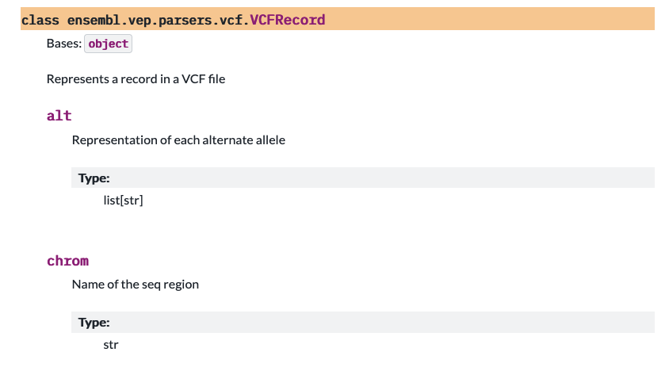

# Building the Documentation

The documentation for this project is produced using the [`ensembl-utils`](https://ensembl.github.io/ensembl-utils/latest/) package, which configures [`Sphinx`](https://www.sphinx-doc.org/) and the [`PyData`](https://pydata-sphinx-theme.readthedocs.io/en/stable/index.html) theme.

The documentation site is produced by the [docs](https://github.com/Ensembl/ensembl-vep-py/blob/main/.github/workflows/docs.yml) GitHub workflow, which runs every time a release is created. The site is available at: [https://ensembl.github.io/ensembl-vep-py](https://ensembl.github.io/ensembl-vep-py)

## Changes to the default configuration

There are some changes to the default configuration, because this project uses the [attrs](https://www.attrs.org) package.
In the `conf.py` file we have added the following options.

```
napoleon_attr_annotations=True,
napoleon_use_rtype=True,
autodoc_typehints="description",
typehints_use_rtype=True,
autodoc_default_options={"member-order": "bysource"}
```

## Documenting Rust objects

Rust objects that are exposed to Python through PyO3 are documented by adding documentation comments to the object and getter methods.

This:
```rust
///    Represents a record in a VCF file
#[pyclass(name = "VCFRecord")]
#[derive(Clone, Debug, PartialEq)]
pub struct VcfRecord {
    /// list[str]: Representation of each alternate allele
    #[pyo3(get)]
    pub alt: Vec<String>,
    /// str: Name of the seq region
    #[pyo3(get)]
    pub chrom: String,
```
produces documentation like this:



## Coverage reports

This project uses both Python and Rust, so there are two separate coverage reports. These are generated, along with the coverage badges, using the `coverage` target in the Makefile of this repository.

## Building the documentation locally

For local testing of the documentation do:
```
make docs-clean && make coverage && make docs
```

The documentation can be previewed by serving the build locally like this:
```
uv run python -m http.server 8000 --directory docs/_build/html
```

For more information on building the docs locally, see the [ensembl-utils documentation](https://ensembl.github.io/ensembl-utils/latest/user_guide/documentation.html)